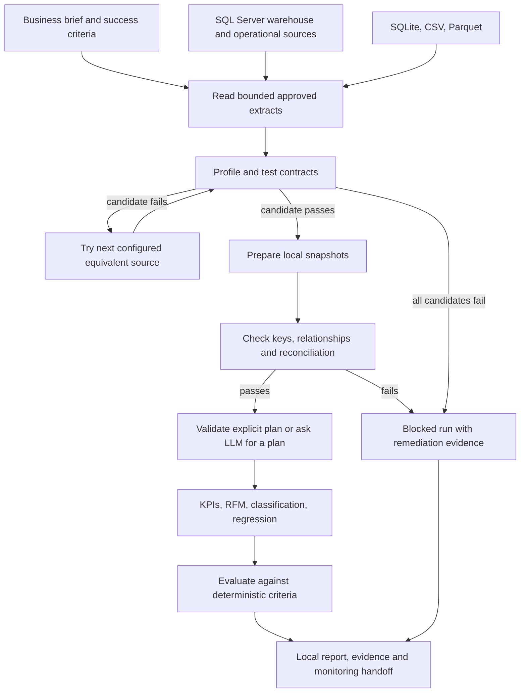

# Architecture and CRISP-DM mapping

The harness is an autonomous **analysis runner with a constrained LLM planner**. A
business brief and approved data definitions establish scope. The planner selects
analytics from a strict schema; maintained Python code performs the actual work.
An LLM cannot execute Python, SQL strings, shell commands or business-system writes.

| CRISP-DM phase | Executable behavior | Main evidence |
| --- | --- | --- |
| Business understanding | Capture objective, decision, business criteria, hypotheses, constraints and as-of date | `business_understanding.json` |
| Data understanding | Read candidate extracts, profile schema/missingness/cardinality, assess contracts, try configured fallback sources | `data_understanding.json`, `snapshots/` |
| Data preparation | Trim strings, apply declared types, remove exact duplicates / explicitly permitted null rows, enforce loss budget, check integrity | `data_preparation.json`, `prepared/` |
| Modeling | Validate a typed plan and execute maintained tools, with fixed predictive estimators | `plan.json`, `results.json`, `analyses/` |
| Evaluation | Compare predictive performance to a baseline, calculate uncertainty, apply acceptance thresholds, retain limitations | `evaluation.json`, optional `interpretation.json` |
| Deployment | Create a local decision-support and monitoring package | `report.md`, `handoff.json` |

CRISP-DM is iterative. This implementation automatically revisits candidate selection
and repairs malformed LLM plans within budgets. It does not weaken contracts, infer
business definitions, or repeatedly tune against a holdout. Changes to the objective,
data definitions or evaluation criteria start a new run; the prior run remains evidence.
See the [IBM CRISP-DM overview](https://www.ibm.com/docs/en/spss-modeler/18.6.0?topic=dm-crisp-help-overview).

## Autonomy boundary

With `task.analyses` omitted, the LLM proposes analysis kinds, columns, grouping and
model parameters from the tool schema. The harness validates dataset scope, column
existence, sensitive fields, approved predictive features, unique analysis IDs and
the analysis budget. Invalid JSON or plans get up to two repair requests. An explicit
task plan takes precedence and is never modified by an LLM.

Source queries are structured configuration, compiled to parameterized SELECTs.
The planner operates on the resulting logical datasets; it does not invent arbitrary
warehouse queries. This makes the first version useful after an initial data onboarding
step. Approved views are the easiest place to encode complex enterprise semantics.

`decision`, `constraints`, `hypotheses` and `success_criteria` are business context,
not executable policy code. Hard controls live in typed contracts, source allowlists,
feature allowlists and numeric acceptance thresholds. A business objective such as
"increase retention" cannot be established from retrospective prediction metrics.

## Data trust

Every candidate must pass its declared contract after permitted local preparation.
Missing tables, unavailable sources, excessive extracts, stale data, conflicting keys,
invalid types, required missing values, ranges and allowed values can reject a candidate.
The first passing candidate wins. A null primary key or conflicting duplicate key is
never repaired by arbitrarily keeping one row. Exact deduplication assumes exact
repetitions are accidental; disable it for datasets where identical rows are legitimate.

Fallback candidates must describe the same population, grain, measurement units,
currency and time window. Quality checks cannot infer semantic equivalence. Selection
records the exact candidate, source, parameterized query and snapshot fingerprint.

Foreign-key and reconciliation dependencies are included automatically, even when
they are absent from the requested analysis list. Cross-dataset failures block analysis.
The runner does not search combinations of source candidates to make reconciliation
pass. No candidates are silently blended. Sums require complete finite numeric values.
Reconciliation is only meaningful for equivalent populations and extraction windows.

SQL queries fetch at most `max_rows + 1`. Encountering the extra row rejects the entire
candidate; it is not a sample. For larger data, use a bounded observation window or
pre-aggregate in the structured query. The row limit bounds transfer, **not** all server
work: joins and aggregates can still scan large tables. ODBC query timeout limits query
execution; DBA resource limits and indexed views can further control workload.

Each extract is individually read and snapshotted. There is no distributed transaction
across warehouse and source systems. Use stable dated extracts / views and reconciliation
for consistency; no `NOLOCK` or dirty-read hints are emitted.

## Statistical behavior

| Tool | Behavior | Acceptance |
| --- | --- | --- |
| `kpi` | Counts, sums and means at configured grain, optional grouping | At least one group survives minimum-group-size suppression |
| `rfm` | Recency, distinct transaction frequency, monetary totals; tie-preserving quintile scores and four descriptive segments | At least 20 customers and a reportable segment; complete identifiers/dates, non-negative amounts |
| `classification` | Binary 0/1 target, logistic regression, prior-probability dummy baseline | AUC improvement exceeds `min_improvement` and bootstrap improvement interval has a positive lower bound |
| `regression` | Ridge regression, mean dummy baseline | Relative RMSE reduction exceeds `min_improvement` and bootstrap improvement interval has a positive lower bound |

Predictive preprocessing is fit inside an sklearn pipeline **after splitting**. Models
require explicit feature allowlists, at least 50 labeled rows, 30 training rows and 10
holdout rows. Binary models also require ten rows per class and both classes in each
partition. Group splits avoid entity overlap; temporal splits keep tied timestamps
together. Choose the split to match the intended prediction setting. A random split is
appropriate only for independent observations. The data owner must verify feature and
label timing; no automated heuristic can certify absence of target leakage.

Bootstrap intervals use 200 resamples and assume independent observations. They are
approximate, especially with group/time dependence. Results state this limitation.
The harness does not tune hyperparameters or pick a model using holdout results.
There is no trained-model serialization, scoring service, automatic retraining or
campaign activation in this version. See [sklearn guidance on leakage and pipelines](https://scikit-learn.org/stable/common_pitfalls.html).

## Privacy and evidence

LLM planning receives the business brief, dataset descriptions, column names/types,
row counts, null rates, distinct counts, sensitivity flags and feature allowlists.
Interpretation receives numeric aggregate metrics and evaluation limitations. Raw
records, examples, category labels, IDs, credentials and connection strings are not
sent. Context supplied in a business brief is sent; keep secrets out of descriptions.
Numeric aggregates and schema can still be sensitive: use an approved inference host.

Contract sensitivity flags plus conservative name heuristics block sensitive fields
from KPI grouping and model features. They are not a complete PII detector. Small
groups are suppressed from local result tables, but this is not differential privacy.
KPI totals in LLM evidence cover only reported groups; suppressed groups remain excluded.

Raw and prepared snapshots stay in the local run directory as Parquet, alongside
auditable reports. They may contain PII. Use an approved encrypted laptop location and
your organization's retention policy. The supplied ignore rules exclude `runs/`, the
demo workspace, local configuration files, `.env` files, and `data/` from Git.

LLM interpretation is labeled as interpretation and must cite valid metric evidence
IDs. This validates references, not the truth of every sentence. Computed evidence
and deterministic gates remain authoritative.

## Extending the harness

Add tools by extending `AnalysisSpec`, `validate_plan`, and `analysis.execute`, with a
deterministic result contract and meaningful tests. Add connector kinds by implementing
bounded reads and explicit cleanup, keeping secrets out of errors. New models should
fit preprocessing only on training data and define a baseline before evaluation.
Do not add `eval`, `exec`, generated code execution or unrestricted SQL as a shortcut.
